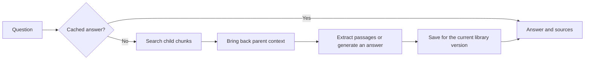

# Evidence QA — Hierarchical RAG with Answer Caching

A document assistant for asking questions about PDFs, Markdown, and text files. Each answer comes with source passages you can check, and repeated questions can reuse an answer from the cache.

You can use it through a Streamlit interface, call the FastAPI endpoints, or work from the terminal. The default mode runs locally without an API key. A separate CPU model setup adds neural retrieval and reranking.

## Why this project exists

A useful document assistant needs more than a convincing response. It needs to show where the answer came from, handle changes to its documents, and make its performance measurable.

This project explores those problems together. It searches small pieces of a document, brings back the surrounding parent sections for context, and keeps cached answers tied to the version of the library that produced them. It also includes tests and evaluation scripts so changes can be compared against a baseline.

## Try it locally

Python **3.12** is the recommended starting point. Open a terminal in the project folder:

```bash
python3.12 -m venv .venv
source .venv/bin/activate
pip install -r rag_cag_project/requirements-dev.txt
cd rag_cag_project
streamlit run app.py
```

On Windows, activate the environment with `.venv\Scripts\activate`. Use `python` or `python3` in place of `python3.12` if that is how your Python 3.12 installation is named.

Once the interface opens:

1. Click **Load fictional demo handbook** in the sidebar.
2. Ask **“What is the minimum attendance requirement?”**
3. Open the source passage to check the answer.
4. Ask the same question again to see an exact-cache hit.

The handbook is fictional sample data. You can upload your own readable PDF, Markdown, or UTF-8 text file instead. Uploading a changed file with the same name replaces the previous version and clears old cached answers. Give the file a different name if you want to keep both documents.

### Use the terminal or API

The following commands run from `rag_cag_project`, with the virtual environment activated.

```bash
python cli.py ingest data/demo/handbook.md
python cli.py ask "What is the minimum attendance requirement?"
```

The text/Markdown CLI needs only the Python standard library. PDF extraction requires `pypdf`, which is included in the application requirements.

To start the API:

```bash
uvicorn app.main:app --host 127.0.0.1 --port 8000
```

Open [the interactive API docs](http://127.0.0.1:8000/docs) to try document uploads, questions, source-page lookup, and deletion. Uploads are limited to 10 MiB and questions to 2,000 characters.

## What happens behind an answer



Child chunks give retrieval a focused search target. Parent expansion supplies more surrounding text before the answer step. Lexical search uses a persistent SQLite FTS5 index; neural embeddings are also saved, so restarting does not require encoding the same chunks again.

Exact caching is enabled by default, with a one-hour expiry and a capacity of 1,000 answers. Simultaneous identical misses share work. Generation capacity remains bounded even when a request disables caching.

Semantic caching is available as an opt-in experiment. Similar wording does not always mean two questions need the same answer, so it uses conservative similarity and wording checks. The included evaluation shows why the threshold needs careful calibration.

## Run the tested CPU models

The CPU path uses quantized ONNX versions of a MiniLM embedding model and a cross-encoder reranker. It runs without PyTorch or provider credentials.

From `rag_cag_project`, using Python 3.12:

```bash
pip install -r requirements-onnx.txt
python -m core.onnx_models --download
export RAG_BACKEND=onnx
export RAG_RERANK=true
streamlit run app.py
```

The download stores about 47 MB of model and tokenizer files in `data/models`. Every file is checked against the revisions and hashes in [models.lock.json](rag_cag_project/core/models.lock.json). Set `RAG_MODEL_DIR` if you want to store the files elsewhere. These downloaded assets are separate from the source ZIP.

The default answer mode extracts matching source sentences. Neural retrieval improves the search step; generated explanations require a generation model.

## Use Gemini for generated answers

From `rag_cag_project`:

```bash
pip install -r requirements-ml.txt
export RAG_GENERATOR=gemini
export GEMINI_API_KEY='your-key'
streamlit run app.py
```

You can keep lexical retrieval, use the tested ONNX backend, or select the separate PyTorch path with `RAG_BACKEND=sentence-transformers`. See the [technical guide](TECHNICAL_GUIDE.md) for configuration details. Gemini may incur provider charges; its live generation path and the PyTorch adapters have not yet been validated with real calls in this project.

The application reads environment variables directly. [.env.example](.env.example) lists the settings, but creating a `.env` file alone will not load them. Restart the application after changing configuration. The `export` examples above use a Unix shell; in PowerShell, use `$env:RAG_BACKEND="onnx"` and the same form for other variables.

## Run the checks

From `rag_cag_project`:

```bash
python -m unittest discover -s tests -v
python -m evaluation.benchmark
python -m evaluation.calibrate_cache
```

Optional real-model tests need the CPU dependencies and downloaded models:

```bash
RAG_RUN_MODEL_TESTS=1 python -m unittest discover -s tests -v
```

Local verification completed with **56 passing tests on Python 3.12 with real models enabled**. They cover document updates, index and embedding persistence, cache races, request limits, API authentication, real-model API calls, PDF extraction, and UI interactions. Without the optional model setup, those model tests skip explicitly.

## What the results show

The main reference evaluation uses **39 real CPython documentation snapshots and 53 development questions**. With CPU reranking, the labelled source ranked first for all 43 answerable questions. Expected answer phrase coverage was about **79%**, and nine of ten unanswerable questions received an abstention.

These measure different things. Finding the right source does not guarantee a complete answer, and matching an expected phrase is not a factual-accuracy score. The questions were written during development and still need independent review.

Cached and uncached mixed HTTP workloads each completed **106 requests at concurrency eight without transport failures**. Basic answerability expectations matched on 96 requests. Cache writes could still increase tail latency on the fast offline workload.

The [benchmark report](BENCHMARKS.md) includes the comparisons, model identities, limitations, and reproduction links. A separate fictional handbook dataset provides a quick regression check.

## Project layout

| Location | Purpose |
| --- | --- |
| `rag_cag_project/core/` | Retrieval, storage, caching, and answer generation |
| `rag_cag_project/app.py` | Streamlit interface |
| `rag_cag_project/app/main.py` | FastAPI service |
| `rag_cag_project/cli.py` | Terminal commands |
| `rag_cag_project/tests/` | Automated checks |
| `rag_cag_project/evaluation/` | Datasets, benchmark scripts, and recorded results |
| `scripts/package_project.py` | Build a clean source folder and ZIP |

## Current limits

Readable PDFs are supported; scanned pages need OCR. Neural search still compares every vector, so very large collections need an approximate search index. Extractive answers can miss useful wording or include related text that does not fully answer the question. Citation identifiers alone do not verify that a generated claim is supported.

The API has request IDs, rate limits, readiness checks, aggregate metrics, and bounded generation. These controls are process-local. Multiple replicas need shared controls, and the Streamlit interface needs hosting authentication before public use.

Docker and CI configurations are included, including a required API key and a container health check. Docker execution, remote CI, and public deployment have not been verified locally. The next evaluation milestone is an independently reviewed, held-out set on new documents.

## More details

- [Technical guide](TECHNICAL_GUIDE.md): API examples, settings, caching, and Docker commands.
- [Benchmark results](BENCHMARKS.md): measured retrieval, answer, cache, and latency results.
- [Validation notes](VALIDATION.md): what ran successfully and what remains unverified.
- [Evaluation guide](rag_cag_project/evaluation/README.md): how to run and extend the experiments.
- [Resume and interview notes](RESUME.md): evidence-based project bullets and a demonstration sequence.
