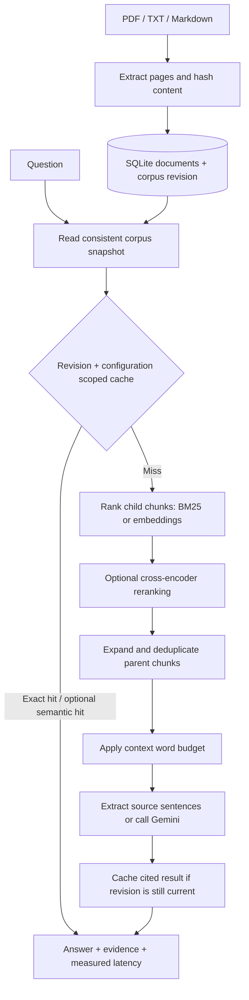

# Evidence QA: Hierarchical Retrieval with Version-Aware Caching

A document question-answering service with parent–child retrieval, page-level evidence, persistent answer caching, and reproducible evaluation. Includes a FastAPI service, Streamlit interface, and dependency-free CLI for Markdown/text documents.

**Status:** local prototype with persistent FTS5 indexing, persisted neural vectors, and verified ONNX CPU retrieval/reranking. Gemini and the separate PyTorch adapters still need live validation. The bundled benchmark is a small fictional development dataset, not evidence of production accuracy.

## Architecture



The default mode uses lexical BM25 retrieval and extractive answers. It works without model downloads or API credentials. Extractive answers quote matching sentences and attach source identifiers; they are not LLM-generated explanations.

## Quick start

Use **Python 3.11 or 3.12** for the pinned UI/ML dependencies. Run from the repository root:

```bash
python3.12 -m venv .venv
source .venv/bin/activate
pip install -r rag_cag_project/requirements-dev.txt
cd rag_cag_project
python cli.py ingest data/demo/handbook.md
python cli.py ask "What is the minimum attendance requirement?"
python -m unittest discover -s tests -v
python -m evaluation.benchmark
```

The CLI and core tests for text/Markdown also work using only the Python standard library. PDF extraction requires `pypdf`.

Launch the UI:

```bash
streamlit run app.py
```

Launch the API in another terminal from `rag_cag_project`:

```bash
uvicorn app.main:app --host 127.0.0.1 --port 8000
```

Open [API documentation](http://127.0.0.1:8000/docs). The Streamlit sidebar supports upload, replacement, deletion and loading the fictional handbook. Answers expose their supporting passages and original page numbers. For TXT/Markdown, the whole document is page 1.

## API

| Endpoint | Purpose |
| --- | --- |
| `GET /health` | Liveness |
| `POST /documents` | Multipart upload (`file`), maximum 10 MiB |
| `GET /documents` | List document IDs and content hashes |
| `DELETE /documents/{id}` | Delete a document and invalidate cached answers |
| `GET /documents/{id}/pages/{page}` | Read the original extracted source page |
| `POST /query` | Ask with `query`, `use_cache`, `semantic_cache`, `hierarchy` |

```bash
curl -F 'file=@data/demo/handbook.md' http://127.0.0.1:8000/documents
curl -H 'Content-Type: application/json' \
  -d '{"query":"What is the minimum attendance requirement?"}' \
  http://127.0.0.1:8000/query
```

Questions have a 2,000-character limit. Same filename means replacement. A changed document increments the corpus revision and clears the answer cache. Identical uploads leave the revision unchanged. Requests operate on a consistent snapshot; an update during generation cannot repopulate the cache with an old-revision answer. A response can still describe the snapshot from before an overlapping update; its `revision` identifies that snapshot. Source links include that revision and return HTTP 409 after library changes, instead of silently showing a different version.

## Optional ML mode

```bash
pip install -r requirements-ml.txt
export RAG_BACKEND=sentence-transformers
export RAG_GENERATOR=gemini
export RAG_RERANK=true
export GEMINI_API_KEY='your-key'
# Optional: export GEMINI_MODEL='a-model-available-to-your-account'
streamlit run app.py
```

Select retrieval and generation independently: Gemini also works with lexical retrieval. Models load only when used. Neural vectors are persisted in SQLite with their chunk and model identities; replacement/deletion cascades through chunks, FTS entries and vectors. Neural scoring uses an exact scan, not ANN. Lexical search uses FTS5 rather than rebuilding a Python index per request. See the root README for the tested, pinned ONNX alternative.

Environment variables are read directly; `.env.example` is a reference and is **not automatically loaded**. Restart the process after changing configuration. `RAG_DB_PATH` overrides the database location; otherwise the path is anchored to the project, independent of your shell directory.

## Cache semantics

- SQLite WAL mode allows concurrent readers during writes.
- Simultaneous identical misses share a Future; generation slots are bounded by `RAG_MAX_INFLIGHT` (default 8), including requests that disable answer caching. Coalesced callers report `cache_type=coalesced` and zero generation tokens. This coordination is per Assistant instance, not cross-process.
- SQLite stores query, complete answer/evidence, timestamp and configuration/revision scope in one atomic row.
- Exact matching is enabled by default. Semantic matching requires explicit opt-in.
- Default limits: 1-hour TTL and 1,000 stored answers; expired entries are ignored and cleaned on writes.
- The cache scope includes retrieval/chunking configuration, generator/model identity and prompt version.
- The semantic threshold defaults to 0.97. Guards reject differing negation/modality, question words and numeric tokens. These heuristics **do not establish semantic equivalence**; calibrate on representative labelled query pairs before enabling.
- Cached responses report zero current-request generation tokens. Latency measures the current request, including cache lookup; `retrieval_ms` on a hit belongs to the original uncached generation.
- The historical name "CAG" in compatibility modules refers to semantic **answer caching**, not model KV-cache preloading.

## Evaluation and results

Run the bundled smoke evaluation:

```bash
python -m evaluation.benchmark --output evaluation/demo_report.json
python -m evaluation.calibrate_cache
# Optional model-based reranker ablation:
python -m evaluation.benchmark --backend sentence-transformers --rerank
# Optional paid generation evaluation (requires SDK and GEMINI_API_KEY):
python -m evaluation.benchmark --generator gemini
# Your separate dataset and document folder:
python -m evaluation.benchmark --dataset /path/to/questions.json --documents /path/to/documents
```

See [evaluation notes](rag_cag_project/evaluation/README.md) and [recorded demo results](rag_cag_project/evaluation/demo_report.json). The 24 questions include 20 answerable and four unanswerable cases. Eight labelled cache pairs exercise two reorderings and six non-equivalent questions.

**Do not describe phrase coverage as factual accuracy or Recall@k.** The current demo is too small and easy to establish a hierarchy advantage. It uses fictional data created alongside the implementation, and the abstention threshold was checked on it. A separate reviewed held-out collection is needed for defensible performance claims.

## Tests

```bash
pip install -r requirements-dev.txt
python -m unittest discover -s tests -v
```

The implementation was verified with 56 tests together in Python 3.12.14 with real models enabled; the Python 3.11/3.12 CI matrix is configured but has not run remotely. See [validation notes](VALIDATION.md).

Tests include headless Streamlit interactions (demo ingestion, answering, exact-cache display and stale-revision warnings), as well as parent expansion, context budgets, citation provenance, cache persistence/expiry/capacity, corpus updates, concurrent access, stale-generation races, semantic mismatch guards, API authentication, input validation, upload limits, and document lifecycle. API tests skip explicitly if their dependencies are missing. GitHub Actions runs the suite on Python 3.11 and 3.12 and executes the smoke benchmark.

## Container deployment

From the repository root:

```bash
docker build -t evidence-qa .
docker run --rm -p 127.0.0.1:8000:8000 \
  -e RAG_API_KEY='replace-with-a-long-random-key' \
  -v evidence-qa-data:/home/assistant/data evidence-qa
```

The container runs as an unprivileged user. `RAG_REQUIRE_API_KEY=true` makes startup fail if the key is absent; the Docker image enables this setting. Its health check probes `/ready`. Pass `X-API-Key` on protected API requests when `RAG_API_KEY` is configured. The bundled image uses offline mode; it does not install the optional ML dependencies.

The API has a bounded process-local per-client limiter (`RAG_RATE_LIMIT`, default 120 requests/minute), `X-Request-ID` headers, `GET /ready` for store readiness and protected `GET /metrics` for aggregate request/latency buckets. Route templates keep metric labels bounded, and request text is not logged. Public hosting still needs TLS, shared controls across workers and operational monitoring. The Streamlit app accesses the engine directly and has no login; keep it local or protect it with hosting authentication. This is a single-library application, not a tenant-isolated service.

## Scope and limitations

- Default extractive abstention uses a 60% query-term coverage gate with a small normalization dictionary (for example, minimum → least). Related text can still fail to answer a question, and synonyms can cause false abstention. This is not an entailment verifier.
- Gemini output is rejected if citation identifiers are absent or invalid. Citation validity does not prove claim support; human review or a separate entailment evaluation is still needed.
- PDF extraction handles readable text, not scanned-page OCR, complex table reconstruction or layout-aware parsing.
- Chunks use words as a transparent context-budget proxy, not model tokens. Provider token usage is returned when Gemini supplies it.
- Child chunks and lexical indexes persist; neural vectors persist by backend/model artifact identity. Approximate nearest-neighbor search remains future work.
- Real CPython documentation is benchmarked with development source labels, not a held-out human-reviewed set. CPU embedding/reranking inference and mixed local HTTP tests have run. Gemini, Docker execution, remote CI and public hosting remain unverified.
- The legacy `chroma_db/` snapshot is unused and retained rather than migrated or deleted. Bundled Jupyter/SymPy dependency assets and the temporary editor script were removed.

## Resume presentation

Describe the implemented architecture and tests now. Add accuracy, cost and latency improvements only after measuring a realistic workload and a held-out dataset. See [ready-to-adapt resume bullets and interview notes](RESUME.md) and [the evidence checklist](rag_cag_project/evaluation/README.md#resume-evidence-checklist).
